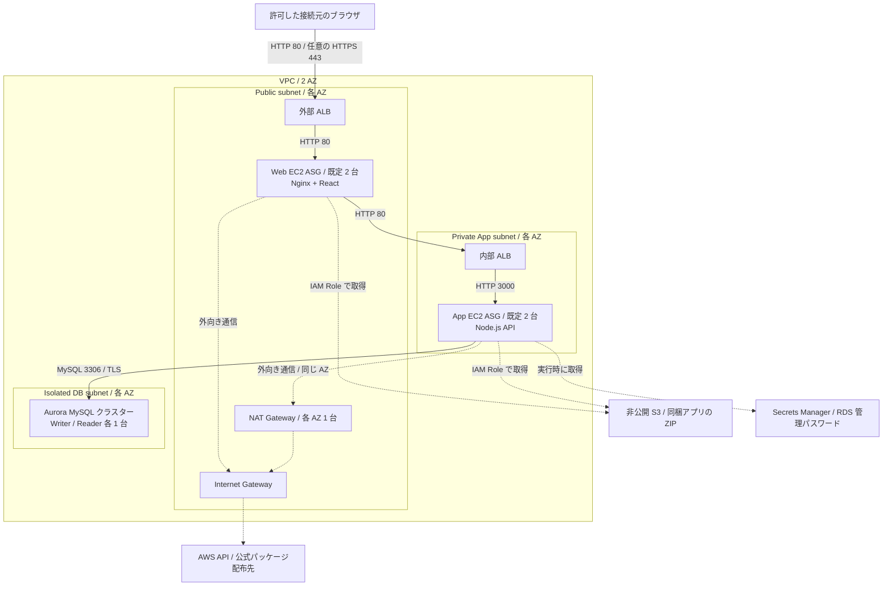

# テーマ A — AWS Web 3 層システム / Terraform

添付の「テーマ A Web 3 層システム」を、独立して使える Terraform ルートモジュールにした学習用サンプルです。リージョンは既定で東京です。**AWS への作成・接続・plan・apply は実施していません。**

同梱の React / Node.js は、この構成の疎通確認用に新規作成した小さなデモです。AWS 公式ワークショップのアプリをコピー・完全移植したものではありません。UI のボタンから Aurora に固定の SELECT を実行し、Writer / Reader それぞれへの接続を確認できます。外部の未提供アプリや架空のダウンロード先には依存しません。

## 構成図（このコードで作成する構成）



実線は主なリクエスト経路、点線は起動・認証情報取得などの補助経路です。S3 / Secrets Manager は subnet の中に配置するサーバーではありません。図はサービス間の論理接続を表し、外部 ALB のインターネット経路は簡略化しています。Web EC2 は public IPv4 を持ち、App EC2 の外向き通信は同じ AZ の NAT Gateway を通ります。

Aurora の Writer / Reader は同一クラスターの共有ストレージを利用します。ALB / DB の削除保護、アクセス元制限、HTTP デモモードの制約は後述を確認してください。

## 1. 図とコードの対応

| 図の要素 | 実装 |
|---|---|
| 2 AZ の VPC | public / app / db を AZ ごとに 1 個、計 6 サブネット |
| 外部向け ALB | public サブネット 2 個に配置。許可したクライアント CIDR のみ受信 |
| Web EC2: Nginx / React | public サブネットの ASG、既定 2 台。Web コンテンツと API リバースプロキシ |
| NAT Gateway | 各 AZ に 1 台。App 層は同じ AZ の NAT を使用 |
| 内部向け ALB | app サブネット 2 個に配置、Web SG からのみ受信 |
| App EC2: Node.js | private app サブネットの ASG、既定 2 台。API を 3000/TCP で提供 |
| Aurora MySQL | isolated db サブネット。最初の AZ に初期 Writer、もう一方に初期 Reader |
| Auto Scaling | Web / App 個別に CPU 60% を目標にスケール、既定 2〜4 台 |

通信経路:

`Client → 外部 ALB:80/443 → Web:80 → 内部 ALB:80 → App:3000 → Aurora:3306(TLS)`

Aurora は同一クラスター内の 2 インスタンスです。独立した DB を独自にレプリケーションする構成ではありません。フェイルオーバー後は Writer / Reader の実体が入れ替わり得るため、アプリはクラスターの Writer / Reader エンドポイントを利用します。Aurora の基盤ストレージはサービス側で 3 AZ に複製され、図の 2 AZ は DB インスタンス配置を表します。

VPC CIDR の先頭から `cidrsubnet(vpc_cidr, 4, 0..5)` を使うため、重複しない 6 サブネットが自動生成されます。既定値 `10.10.0.0/16` では、それぞれ `/20` です。DB ルートテーブルには VPC 内向けの local ルートしかありません。

## 2. 前提とバージョン

- Terraform 1.7 以上、2.0 未満（作成時のローカル確認: 1.16.5）
- HashiCorp AWS Provider 6.68 以上、7 未満。lockfile は 6.68.0
- HashiCorp Archive Provider 2.x。lockfile は 2.8.1
- AL2023 x86_64 AMI、Node.js 22、Nginx
- 東京で利用可能な 2 AZ、EC2 / Aurora のインスタンスクラスとサービスクォータ
- 実際にデプロイする場合だけ、利用者自身の AWS 認証と VPC・EC2・ELB・Auto Scaling・RDS・IAM・S3・Secrets Manager 関連の作成権限

`.terraform.lock.hcl` と各 `package-lock.json` を同梱しています。Terraform Provider と npm の推移的依存は lockfile に記録されています。Node / Nginx の OS パッケージは起動時に AL2023 の公式リポジトリから取得します。

`ami_id = null` は AWS 公開 SSM Parameter から最新 AL2023 AMI を選びます。`db_engine_version = null` は対象リージョンで利用可能な Aurora MySQL 8.0 ファミリーの新しいバージョンを plan 時に選びます。**初回 plan を確認したら両者を固定してください。** 自動選択のままだと将来の plan で更新が提案されることがあります。リージョンを変えるときは `availability_zones` も必ず変更してください。

## 3. ファイル構成

- `versions.tf` / `variables.tf` / `outputs.tf`: Provider、入力、出力
- `main.tf`: VPC、サブネット、IGW、NAT、ルート
- `security.tf`: SG と層間の最小限の通信規則
- `load-balancers.tf`: 2 ALB、Target Group、HTTP / 任意の HTTPS
- `compute.tf`: Launch Template、ASG、スケーリング、ローリング更新
- `database.tf`: Aurora、2 DB インスタンス、TLS 強制、削除保護
- `artifacts-iam.tf`: 非公開 S3 のソースアーカイブと EC2 IAM
- `templates/`: EC2 起動スクリプト
- `demo/`: 独自の React / Node.js デモと npm lockfile
- `tests/`: AWS を呼ばないテスト、テンプレート検証用 fixture

Terraform は同梱ソースを ZIP にし、apply 時に非公開 S3 にアップロードします。EC2 は自身の IAM Role で対応する 1 個のアーカイブを読み込み、`npm ci --ignore-scripts` とビルドを実行します。ZIP のキーは内容の SHA-256 を含むため、ソース変更が Launch Template の更新に反映されます。`artifacts-iam.tf` の `artifact_files` に列挙した各 4 ファイルだけを含め、ディレクトリ全体は梱包しません。`.npmrc`、秘密鍵、`.env`、依存キャッシュ等のローカルファイルを自動混入させないためです。アプリのファイルを追加したときは、この許可リストとテストもレビューして更新してください。許可したソースファイル自体にも秘密を記入しないでください。

## 4. 設定・確認・実行手順

ここからの AWS コマンドは利用者が後で実行する手順です。この成果物の作成時には実行していません。

```sh
cp terraform.tfvars.example terraform.tfvars
# terraform.tfvars を編集
terraform init
terraform fmt -check -recursive
terraform validate
terraform test
```

必須の編集:

1. `allowed_client_cidrs` を実際の接続元グローバル IPv4 `/32` 等に変更する。例の `203.0.113.10/32` は文書用アドレスなので、そのままでは自分の PC からアクセスできません。全世界向け `/0` は入力エラーになります。複数の広い CIDR に分けても安全にはならないため、実際の接続元に絞ってください。
2. `name` と `tags.Owner` を環境ごとに設定する。
3. 希望するリージョン・2 AZ・台数・インスタンスサイズを確認する。
4. 同リージョンの既存 ACM 証明書 ARN を設定し、その証明書に一致するドメインの DNS Alias / CNAME を外部 ALB に向ける。証明書と DNS レコード自体はこの例では作成しません。一時的な HTTP デモだけは `allow_insecure_http = true` で明示的に許可できます（例の tfvars はこの設定）。変数の既定値は `false` なので、証明書も明示許可もない構成は拒否します。HTTPS で使う際は例の値を `false` に戻してください。

実際のアカウントを選んだ後に:

```sh
# 自分で設定済みの AWS_PROFILE / AWS SSO 等を使用
aws sts get-caller-identity
terraform plan -out=theme-a.tfplan
# 追加資源、費用、選択された AMI / DB バージョンを確認
# デプロイすると決めたときだけ次を実行
terraform apply theme-a.tfplan
```

`archive_file` が plan 時に生成する `web-artifact.zip` と `app-artifact.zip` を apply まで保持してください。CI の plan / apply を別マシンで実行する場合も、plan ファイルと同じソース・アーカイブを引き継ぐ必要があります。

ALB ヘルスチェックが成功するまで ASG の作成を待ちます。Aurora の作成と初回 npm ダウンロードを含むため、完了まで時間がかかります。起動時は AWS API、AL2023 / npm のリポジトリ、RDS CA 配布先への HTTPS 接続が必要です。

### 動作確認

証明書なしの場合:

```sh
terraform output -raw web_url
curl "$(terraform output -raw web_url)/healthz"
curl "$(terraform output -raw web_url)/api/health"
curl "$(terraform output -raw web_url)/api/reader"
```

証明書ありの場合は `web_url` の ALB 生 DNS 名ではなく、証明書に一致する自分のドメインを使用してください。ALB DNS 名そのものにはその証明書が一致しないため、HTTPS の直接アクセスは証明書エラーになります。

- `/healthz`: Web または App 自体の生存確認。DB 障害で EC2 が大量に置換されるのを防ぐため、DB を問い合わせません。
- `/api/health`: Writer エンドポイントに SELECT。JSON の `ok: true` を確認
- `/api/reader`: Reader エンドポイントに SELECT。通常 `database.read_only: 1` を確認
- UI の 2 ボタンからも同じ確認ができます。業務データの登録・更新 API はありません。

障害時は Systems Manager Session Manager から確認します。SSH キーや 22/TCP の開放はありません。

```sh
sudo tail -100 /var/log/cloud-init-output.log
sudo systemctl status nginx                   # Web
sudo nginx -t                                # Web
sudo systemctl status three-tier-app          # App
sudo journalctl -u three-tier-app -n 100       # App
```

ASG の `desired_capacity` はスケーリングと競合しないよう Terraform で変更を無視します。初回以降の手動台数変更は ASG 側で行うか、意図を確認して `ignore_changes` の扱いを変更してください。最小・最大台数は Terraform から変更できます。

## 5. セキュリティと、図で省略されていた前提

- Web EC2 は図どおり public サブネットに置き、起動時のダウンロードと SSM 用の public IPv4 を付与します。外部から Web EC2 へ直接受信する許可はなく、Web SG は外部 ALB SG からの 80/TCP のみ受けます。
- App EC2 と Aurora に public IPv4 はありません。DB サブネットにはインターネットへの経路もありません。
- Web → 内部 ALB → App → DB を、それぞれ送受信側の SG 参照で限定。外部 ALB は指定 CIDR だけ許可。Web / App の外向き HTTPS はパッケージ、SSM、S3、Secrets Manager 用に許可します。
- EC2 は IMDSv2 必須、root EBS は暗号化。Aurora ストレージも暗号化。
- RDS が管理する DB パスワードを Secrets Manager に保存。Terraform はパスワード値を入力・出力・取得せず、ARN のみ扱います。App が実行時に値を取得し、メモリーに短時間キャッシュします。認証失敗時は再取得を 1 回試します。
- DB は TLS 必須。アプリは RDS CA とホスト名を検証します。パスワードを起動スクリプト、ログ、tfvars に埋め込みません。
- **学習用の簡略化として App は管理ユーザーで固定 SELECT を実行します。** 本番では専用の最小権限 DB ユーザーとその認証方式に置き換えてください。Web の IAM Role に DB Secret 読み取り権限はありません。
- ACM 証明書を未指定の場合は `allow_insecure_http = true` の明示許可が必要で、**HTTP のみ**です。HTTP では盗聴・改ざんを防げないので機密情報を扱わないでください。認証、WAF、クライアント別 rate limit、ALB アクセスログ、VPC Flow Logs、監視アラーム、アプリログの集中収集、専用の Secrets Manager / SSM VPC Endpoint は未追加です。本番運用の完成品ではありません。
- API はプロセスごとに DB 確認の同時処理を 8 件までに制限し、超過分はキューにためず `503` / `Retry-After: 1` を返します。`/healthz` は飽和中も DB を呼ばず応答します。これは小規模デモの過負荷対策であり、認証・WAF・全インスタンス共通の流量制限の代わりにはなりません。
- 内部の ALB と EC2 間は HTTP です。組織の規定で内部暗号化が必要なら、内部 HTTPS / mTLS 等を別途設計してください。
- DB バックアップ保持 7 日、ALB と DB の削除保護は既定で有効。ALB / ASG の 2 AZ 配置は障害耐性を高めますが、全ての障害で無停止になる保証ではありません。
- state に管理パスワード値は入りませんが、識別子や構成を含みます。state / plan / tfvars を公開せず、共有運用では暗号化・アクセス制御・ロック付き remote backend を別途設定してください。

## 6. 費用と削除

この構成は無料前提ではありません。**NAT Gateway 2 台、ALB 2 台、EC2 最低 4 台、Aurora 2 台** に加え、EBS、Aurora ストレージ、public IPv4、S3、Secrets Manager、CloudWatch、データ転送等で継続課金されます。最新の東京リージョン料金を AWS Pricing Calculator 等で確認してください。

削除する場合:

1. 必要なデータをバックアップし、`final_snapshot_identifier` が既存スナップショットと重複しないことを確認。
2. `terraform.tfvars` の `deletion_protection = false` に変更し、`terraform apply` で反映。
3. 削除対象を確認して `terraform destroy` を実行。
4. 既定の `skip_final_snapshot = false` なら最終 DB スナップショットが残ります。削除後もそのストレージ料金が発生するため保持要否を確認。

一時的な学習データを本当に破棄してよい場合だけ、事前に `skip_final_snapshot = true` を設定してください。アーティファクト用 S3 は再作成できるデモソース専用なので `force_destroy = true` です。重要なファイルを追加保管しないでください。

## 7. 検証状況

2026-10-14、AWS アカウントにアクセスしないローカル確認を実施しました。

| 確認 | 結果 |
|---|---|
| `terraform fmt -check -recursive` | 成功 |
| `terraform init -backend=false` | 成功。公式署名付き AWS 6.68.0 / Archive 2.8.1 を取得 |
| 実テンプレートの Terraform `templatefile` 評価 | 成功。Provider なしの `tests/render` で確認 |
| レンダリング後の `bash -n` | Web / App とも成功。user-data はそれぞれ 2,141 / 1,827 バイト |
| `node --test tests/api.test.mjs` | 5 件成功。ヘルス、Writer、Reader、エラー秘匿、未知ルート / 書き込み拒否 |
| npm lockfile からの依存解決 | Web / App とも成功（ローカル Node.js 24.19.0） |
| React / esbuild 本番ビルド | 成功。JS 約 219 KiB |
| Node API 構文検査 | 成功 |
| `terraform validate` / AWS Provider スキーマ検証 | **未完了**。実行環境が Provider の Unix RPC socket を拒否し、スキーマ読み込み前に停止 |
| `terraform test` の AWS mock テスト | **未実行**。同じ Provider 起動制限があるため |
| 実 AWS plan / apply、EC2 AL2023 起動、実 DB 疎通 | **未実行** |

したがって「AWS デプロイ済み」「実機で end-to-end 動作確認済み」ではありません。利用する環境で `terraform validate` → `terraform test` → レビュー付き plan を必ず行ってください。SDK・AL2023 パッケージ・東京での DB クラス対応などの実際の作成可否はその時点で確認が必要です。

`tests/architecture.tftest.hcl` は AWS Provider を mock 化しています。ネットワーク境界、2 AZ / 台数、managed secret、暗号化、HTTPS 切替、不正入力を確認するテストを収録しています。通常の Terraform test に AWS 認証は不要ですが、Provider を起動できるローカル環境が必要です。

### 2026-10-17 セキュリティ修正の再検証

- `terraform fmt -check -recursive`: 成功
- `node --test tests/*.test.mjs`: 7 件成功。DB 同時処理上限、過負荷中のヘルスチェック、成功・失敗後の処理枠解放を追加確認
- `node --check demo/app/server.mjs` / `node --check demo/app/handler.mjs`: 成功
- Web / App の `npm ci --ignore-scripts`（App は `--omit=dev`）と React / esbuild 本番ビルド: 成功
- 実テンプレートの Terraform 評価と `bash -n`: Web / App とも成功
- Web / App 両方の `npm audit --package-lock-only --ignore-scripts`: 既知脆弱性 0 件（監査時点。将来の安全性を保証するものではありません）
- Terraform mock テストに、ZIP の許可ファイル、全世界向け CIDR・不正 CIDR・IPv6・空リストの拒否、HTTP 明示許可を追加
- `variables.tf` をそのままコピーした Provider 不要の一時 fixture: 接続元 CIDR と HTTP 安全既定値の 6 ケース成功
- `terraform validate` / `terraform test`: Provider 起動時の IPC 制限で完了できず。上の Terraform 回帰テストは Provider を起動できる環境で確認が必要
- 実 AWS の plan / apply、実 DB 疎通は未実施

## 8. 参照した一次情報

- [AWS Three Tier Web Architecture Workshop](https://github.com/aws-samples/aws-three-tier-web-architecture-workshop): 図のベースである Nginx / React → 内部 ALB → Node.js → Aurora の対応を確認
- [Terraform AWS Provider / RDS Cluster](https://registry.terraform.io/providers/hashicorp/aws/latest/docs/resources/rds_cluster): RDS 管理パスワード、Aurora 設定
- [Terraform AWS Provider / Launch Template](https://registry.terraform.io/providers/hashicorp/aws/latest/docs/resources/launch_template): IMDSv2、EBS、user-data
- [Amazon Linux 2023 / Node.js](https://docs.aws.amazon.com/linux/al2023/ug/nodejs.html): `nodejs22`, `nodejs22-npm`, `node-22`, `npm-22`
- [Aurora と Secrets Manager](https://docs.aws.amazon.com/AmazonRDS/latest/AuroraUserGuide/rds-secrets-manager.html)
- [RDS CA 証明書](https://docs.aws.amazon.com/AmazonRDS/latest/UserGuide/UsingWithRDS.SSL.html)
- [Terraform 公式インストール](https://developer.hashicorp.com/terraform/install)
- [HashiCorp Archive Provider / archive_file](https://registry.terraform.io/providers/hashicorp/archive/latest/docs/data-sources/file): 明示したファイルだけを `source` ブロックで梱包
- [AWS VPC Security groups](https://docs.aws.amazon.com/vpc/latest/userguide/vpc-security-groups.html): 必要な接続元だけへの受信制限
