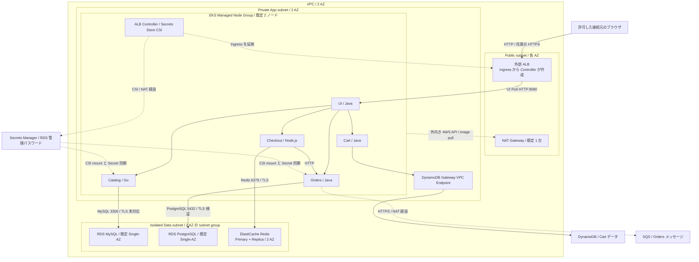

# テーマB: マイクロサービス / Kubernetes

図の AWS Containers Retail Store Sample App を、EKS とマネージドデータストアで再現する学習用 Terraform です。AWSリソース作成や実アカウントに対する plan/apply は実行していません。実環境での疎通・注文処理は未検証です。

## 構成図（既定値の論理構成）



実線は主なアプリの接続、点線は AWS API・管理・Secret 取得の論理接続です。NAT の先の Internet Gateway は省略しています。DynamoDB / SQS / Secrets Manager はリージョナルサービスで、Data subnet 内に置くサーバーではありません。ALB からは Ingress の `target-type=ip` により UI Pod に転送します。各サービスの内部通信は Kubernetes Service（80 → Pod 8080）を利用します。

既定ではアプリは各 1 replica で、5 サービスを各 AZ に 1 個ずつ配置する構成ではありません。MySQL / PostgreSQL もそれぞれ Single-AZ です。Catalog の DB 通信 TLS、Secret ローテーション後の Pod 再起動、その他の制約を必ず下記で確認してください。

## 図との対応と採用した前提

- 図の「EKS / ECS」はタイトルに合わせて **EKS** を採用。EC2 マネージドノードを App 用 private subnet 2 AZ に配置します。
- 「Amazon MQ / SQS」は **SQS** を採用。Orders の公式 v1.6.3 実装に SQS メッセージ送信機能があることをソースで確認しています。
- インターネット向け ALB → Java UI → Catalog / Cart / Checkout / Orders。ALB は AWS Load Balancer Controller が Ingress から作成します。Terraform で別の ALB を重複作成しません。
- Catalog: Go → RDS MySQL 8.0、Cart: Java → DynamoDB、Checkout: Node.js → ElastiCache Redis 7.1、Orders: Java → RDS PostgreSQL 16 + SQS。
- Checkout → Orders の接続も設定済み。DynamoDB のキー id と GSI idx_global_customerId は公式コードと一致させています。
- DynamoDB / SQS はリージョナルサービスであり、実際には Data subnet 内へ配置されるリソースではありません。DynamoDB は無料の Gateway VPC Endpoint、SQS / STS / Secrets Manager / イメージ取得などは NAT 経由です。

## 最初に知っておく制約

これは本番向け完成基盤ではありません。特に次の点は意図的な簡略化です。

1. **Catalog v1.6.3 は MySQL 接続の TLS 設定を持たないため、Catalog→MySQL は VPC 内でも非暗号化です。** 接続元を worker node の SG に限定し、RDS 保存時暗号化は有効ですが、通信暗号化の代替にはなりません。require_secure_transport=OFF を明示しています。本番利用前に Catalog を TLS 対応へ変更し、CA 検証と DB 側 TLS 強制を追加してください。
2. Redis は TLS 必須 / 保存時暗号化 / 2 AZ の primary+replica ですが、サンプルでは AUTH/ACL 認証を設定していません。同じ node SG からの到達性を許す構成です。本番では認証・Pod 単位の分離を追加してください。
3. PostgreSQL は rds.force_ssl=1。Orders の JDBC 接続には sslmode=verify-full と同梱の AWS RDS CA を渡します。CA の更新は運用者が管理してください。
4. RDS の管理パスワードは AWS が生成して Secrets Manager に保存し、Pod 起動時に CSI が取得します。Terraform は秘密の値を読みません。ただしアプリが管理ユーザーを利用する学習用構成です。本番はマイグレーション用とアプリ用の最小権限ユーザーを分けてください。
5. CSI は secret rotation と Kubernetes Secret 同期を有効にしていますが、**環境変数は自動更新されません**。RDS 管理パスワードの自動ローテーション後は Catalog / Orders の Pod 再起動が必要です。再起動自動化 / 設定の動的再読み込みは未実装です。ローテーションを放置すると再接続に失敗します。
6. デフォルトは HTTP です。アクセス元 CIDR の指定が必須です。デモに個人情報・決済情報・本物の認証情報を入力しないでください。本番公開には ACM 証明書、DNS、認証、WAF、監視等が必要です。ACM ARN とホスト名を設定すると ALB HTTPS + HTTP→HTTPS リダイレクトになります。
7. 低コスト寄りの設定として NAT は 1 台、RDS は Single-AZ、アプリは各 1 replica。ノード 2 台 / 2 AZ でもシステム全体が HA になるわけではありません。node の配置 AZ の実績も確認してください。
8. node SG はアプリで共有し、NetworkPolicy / Security Groups for Pods は実装していません。Pod ごとの IAM は IRSA と ServiceAccount 条件で分離しています。ノードロールは EKS/CNI/ECR 用だけで、Cart の DynamoDB、Orders の SQS、DB secret の読み取りは専用 Pod ロールです。
9. Orders は SQS へ送信するだけです。後続コンシューマー、DLQ / 再試行ワーカーは図にないため未実装。メッセージ保持期間は 4 日です。Cluster Autoscaler、HPA、アプリログ転送・アラームも未実装です。

## 構成と適用順

```
01-infra/     VPC、subnet、NAT、EKS、IAM、RDS、Redis、DynamoDB、SQS
02-platform/  ALB Controller、Secrets Store CSI Driver、AWS Provider
03-apps/      Namespace、ServiceAccount、SecretProviderClass、5サービス、Ingress
scripts/      ローカル検証と DB 利用 Pod の再起動補助
```

**3 段階は別 state です。** EKS が作られる前に Kubernetes / Helm provider を初期化する問題と、CRD が存在する前に SecretProviderClass を plan する問題を避けるため、同時適用・単一 root への結合はしないでください。各段階の apply が完了してから次の段階で plan してください。

デフォルトは同じフォルダ階層のローカル state を参照します。フォルダ移動・state 紛失に注意し、state と lock file を保管してください。共同作業では事前に暗号化・アクセス制限・ロック対応の S3 backend を別途用意し、各 root の backend と 02/03 の terraform_remote_state をすべて同じ構成へ変更してください。このコードは state bucket 自体を作りません。

## 必要なもの

- Terraform 1.10 以上 2.0 未満。ローカル整形確認に使用: 1.16.5。
- AWS CLI v2 と kubectl。EKS 1.35 の kubectl を推奨。
- AWS認証済みの作業プロファイル。VPC / EKS / EC2 / IAM / RDS / ElastiCache / DynamoDB / SQS / CloudWatch / Secrets Manager の作成・削除、EKS access entry / service-linked role 等に必要な権限。
- admin_principal_arn は後続の Helm / kubectl を実行する IAM role または IAM user の ARN。STS assumed-role セッション ARN ではありません。AWS SSO 利用時は実際の IAM ロール ARN を管理者に確認してください。
- admin_cidrs に作業端末・CIの固定出口 IPv4 CIDR。EKS API は private + CIDR 制限付き public endpoint です。VPN / プロキシ切替時には出口IPが変わる点に注意。
- 東京リージョンに必要なクォータと、設定した RDS minor version / node type の提供状況。リージョンは変更可能ですが商用 AWS パーティションを対象としています。

## デプロイ手順（ご自身で内容・費用を確認してから実行）

```bash
cd theme-b-microservices
export AWS_PROFILE=your-profile
cp 01-infra/terraform.tfvars.example 01-infra/terraform.tfvars
# terraform.tfvars のアカウントID、IAM ARN、admin_cidrs、client_cidrs を編集。
# 198.51.100.10/32 は説明用の予約アドレスで、そのままでは接続できません。

terraform -chdir=01-infra init
terraform -chdir=01-infra fmt -check
terraform -chdir=01-infra validate
terraform -chdir=01-infra plan -out=tfplan
terraform -chdir=01-infra apply tfplan

# region/name を変更した場合は読み替えます。
aws eks update-kubeconfig --region ap-northeast-1 --name retail-demo
kubectl get nodes -o wide
kubectl -n kube-system get pods

terraform -chdir=02-platform init
terraform -chdir=02-platform validate
terraform -chdir=02-platform plan -out=tfplan
terraform -chdir=02-platform apply tfplan
kubectl wait --for=condition=Established --timeout=120s \
  crd/secretproviderclasses.secrets-store.csi.x-k8s.io
kubectl -n kube-system rollout status deployment/aws-load-balancer-controller --timeout=300s
kubectl -n kube-system get pods

terraform -chdir=03-apps init
terraform -chdir=03-apps validate
terraform -chdir=03-apps plan -out=tfplan
terraform -chdir=03-apps apply tfplan
kubectl -n retail get pods,svc,ingress
terraform -chdir=03-apps output -raw store_url
```

初回は EKS / RDS などの作成に時間がかかります。02/03 は admin_principal_arn と同じ IAM 身元で実行してください。aws eks update-kubeconfig はローカル kubeconfig を更新しますが、Terraform provider 自体は aws eks get-token を使ってトークンを都度取得します。

HTTPS を使う場合、03-apps/terraform.tfvars を次のように設定します。同じリージョンの検証済み ACM 証明書が必要です。DNS の CNAME / Alias 登録は別作業です。

```hcl
certificate_arn = "arn:aws:acm:ap-northeast-1:123456789012:certificate/REPLACE-ME"
hostname        = "shop.example.com"
replicas        = 2
```

画像 tag は 1.6.3 を固定しています。タグ可変性への対策として、本番では検証済みイメージを自社 ECR にミラーして digest pin / 脆弱性検査を行ってください。単に image_tag を変えるだけで将来版の環境変数互換性が保証されるわけではありません。

## 動作確認と切り分け

- 許可した client_cidrs の端末から store_url を開き、商品表示→カート追加→Checkout→注文を確認します。実行時テストはこの納品では実施していません。
- kubectl -n retail get events --sort-by=.lastTimestamp で SecretProviderClass / Secret mount / image pull の問題を確認。
- kubectl -n retail logs deployment/catalog、deployment/orders、deployment/carts で DB / DynamoDB / SQS の接続エラーを確認。秘密値がログに出ないよう扱ってください。
- Catalog/Orders が CreateContainerConfigError の場合、CSI volume の同期、IRSA の ServiceAccount・namespace・aud/sub 条件を確認。Terraform で secret 値を表示・埋め込む回避策は不要です。
- IAM: Cart は自身のテーブルと GSI だけ、Orders は自身の queue と DB secret だけ。アプリによる DynamoDB table 再作成は false に固定しています。
- EKS API の 401/403 は access entry と AWS プロファイル、タイムアウトは admin_cidrs とネットワークを確認。
- ALB が作成されないときは kubectl -n kube-system logs deployment/aws-load-balancer-controller と Ingress events を確認。
- 秘密のローテーション後に CSI が更新されるのを確認したうえで、scripts/restart-db-workloads.sh を実行すると Catalog / Orders の環境変数を更新できます。これにはクラスタへの変更権限が必要です。

## 変更できる主な設定

01-infra/variables.tf: region、name、VPC CIDR、EKS version、node size/台数、NAT 1台/2台、RDS instance class/Multi-AZ、Redis node type、削除保護など。

- NAT の可用性を上げる: single_nat_gateway=false
- DB の可用性を上げる: db_multi_az=true
- RDS メジャーバージョンは parameter group family とセットです。8.0/16 以外への変更はこのコードの追加修正が必要。
- node AMI は AL2023 x86_64 固定。Graviton node への変更は ami_type と instance type を合わせてください。
- EKS add-on は初回 plan 時に指定 Kubernetes version に対応する版を取得します。most_recent=true のため、後の plan で更新差分が出る場合があります。更新内容を確認し、本番では運用基準に従い固定してください。

## 費用と削除

未デプロイでもコード内で将来作成される有料サービスは多数あります。EKS control plane、EC2/EBS 2台、NAT + EIP、ALB + public IPv4、RDS 2台、Redis 2台、CloudWatch Logs、Secrets Manager、バックアップ・転送・リクエスト等が課金対象です。アプリを使わない時間も固定費が発生します。無料枠を前提にしないでください。料金はリージョン・実行時間・通信量で変わるため [AWS Pricing Calculator](https://calculator.aws/) で確認してください。

**削除は 03 → 02 → 01 の逆順。** 最初に EKS / Controller / namespace を消すと ALB / target group / ENI の finalizer 処理ができず、残存リソースと課金が発生するおそれがあります。

1. 保持が必要なデータのバックアップと state の保存を確認します。
2. 01-infra/terraform.tfvars の deletion_protection=false と一意の final_snapshot_suffix を設定し、01-infra の plan/apply で RDS / DynamoDB の削除保護を解除します。バックアップ不要の学習環境でのみ、自己判断で skip_final_snapshot=true を設定してください。
3. 次の順序で destroy を実行します。各 plan/destroy の変更対象を確認してください。

```bash
terraform -chdir=03-apps plan -destroy
terraform -chdir=03-apps destroy
# ALB Controller が ALB/target group の削除を完了したことを AWS 側でも確認。
# 必要なら ARN/名前を AWS Console または CLI で照合し、まだ残っている場合は次へ進まない。
terraform -chdir=02-platform plan -destroy
terraform -chdir=02-platform destroy
terraform -chdir=01-infra plan -destroy
terraform -chdir=01-infra destroy
```

最終 RDS snapshot はデフォルトで残り、別途課金されます。以前の手動 snapshot、バックアップ、クラスタ外の DNS / ACM 証明書等もこの destroy の管理外です。AWS側で残存リソースを確認してください。削除済み secret と共に snapshot を保持する場合は、復元後の認証情報を再設定する運用が必要です。

## 検証結果と根拠

検証日: 2026-10-14。詳細は [VALIDATION.md](VALIDATION.md)、公式ソースへのリンクは [SOURCES.md](SOURCES.md)。

- Terraform fmt は実行し、全 root の HCL は Terraform init で読み込めています。
- 3 root の init -backend=false は公式署名付き provider を取得して成功。lock file を同梱。
- terraform validate はこの実行環境で provider プロセスの Unix socket 起動が制限されるため完了できていません。構文検査の成功を AWS / Kubernetes の実行時検証成功とは扱っていません。
- AWSアカウントへの接続、実 plan/apply、kubectl apply、ブラウザでの注文テストは未実施です。
